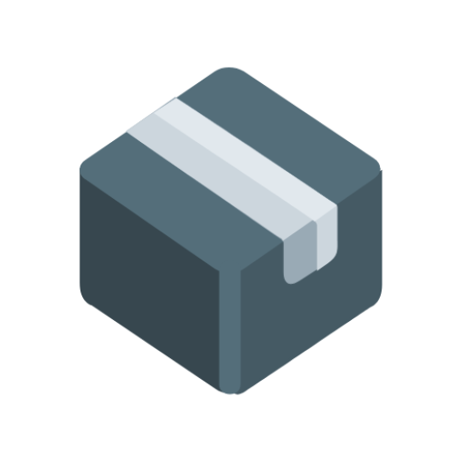

# 🚀 دانلود مستقیم و تک‌کلیکه کلاینت‌های V2Ray (نسخه یونیورسال برای همه گوشی‌ها) | نرم‌افزار اتصال و کانفیگ تست رایگان روزنه نت (Roozaneh Net)

> **«دانلود مستقیم آخرین نسخه رسمی کلاینت‌های V2Ray، Xray و VLESS بدون نیاز به گوگل‌پلی»**  
> بدون سردرگمی بین پردازنده‌های مختلف؛ فقط با **یک کلیک** نسخه کامل و یونیورسال (<bdi>Universal APK</bdi>) سازگار با تمامی مدل‌های گوشی را دریافت کنید، همراه با آموزش تصویری و **۲ الی ۳ گیگابایت کانفیگ پرسرعت تست رایگان هدیه روزنه نت**.

---

> [!NOTE]
> 🌐 **شبکه وب‌سایت‌های لایو روزنه نت (<bdi>Live Web Network</bdi>):**  
> [🛍️ وب‌سایت خرید VPN و تست](https://roozaneh.github.io/kharid-vpn-filter-shekan/) • [📡 وب‌سایت کانفیگ‌های ایران](https://roozaneh.github.io/v2ray-configs-iran/) • [🛡️ وب‌سایت تانل اینترنت ملی](https://roozaneh.github.io/iran-tunnel-v2ray-netmeli/) • [📲 وب‌سایت دانلود نرم‌افزارها](https://roozaneh.github.io/v2ray-clients-download/)
> 
> 📌 **دانشنامه رسمی خرید کانفیگ و استعلام قیمت در گیت‌هاب:**  
> [📖 مطالعه راهنمای جامع خرید کانفیگ V2RayNG و فیلترشکن V2Ray (ایشو رسمی شماره ۱)](https://github.com/roozaneh/kharid-vpn-filter-shekan/issues/2)

### ⚡ شروع سریع در ۳ گام ساده (اتصال در ۳۰ ثانیه):
<kbd> ۱. دانلود مستقیم فایل با یک کلیک </kbd> ➔ <kbd> ۲. دریافت ۲ تا ۳ گیگابایت تست رایگان </kbd> ➔ <kbd> ۳. کپی لینک و اتصال فوری </kbd>

**[🎁 برای دریافت آنی ۲ الی ۳ گیگابایت کانفیگ تست رایگان روزنه نت اینجا کلیک کنید ←](https://t.me/RoozanehNetBot?start=gh_download)**

---

> [!WARNING]
> **🚨 هشدار بسیار مهم درباره حذف شدن <bdi>v2rayNG</bdi> از گوگل‌پلی (<bdi>Google Play</bdi>):**  
> اپلیکیشن رسمی **<bdi>v2rayNG</bdi>** مدت‌هاست که به دلیل محدودیت‌های گوگل از فروشگاه گوگل‌پلی حذف شده است. تمامی برنامه‌هایی که در حال حاضر با نام‌ها یا آیکون‌های مشابه در گوگل‌پلی قرار دارند، **نسخه‌های غیررسمی، آلوده به تبلیغات مخرب یا بدافزارهای جاسوسی** هستند. نسخه اصلی و امن این نرم‌افزار صرفاً از طریق مخزن رسمی متن‌باز گیت‌هاب عرضه می‌شود که لینک مستقیم فایل نصبی خام آن بدون واسطه در جدول زیر قرار داده شده است.

> [!TIP]
> **💡 چرا نسخه یونیورسال (<bdi>Universal APK</bdi>)؟**  
> برای اینکه درگیر اصطلاحات فنی مثل `arm64-v8a` یا `armeabi-v7a` نشوید، تمامی لینک‌های اندروید این صفحه مستقیماً به **نسخه یونیورسال** متصل هستند. نسخه یونیورسال شامل تمام کتابخانه‌هاست و روی ۱۰۰٪ گوشی‌های سامسونگ، شیائومی، هواوی و تبلت‌ها بدون هیچ اروری نصب می‌شود.

> [!IMPORTANT]
> **🔄 ویژگی انحصاری «قانون عدم سوختن حجم مشترکین» (<bdi>Data Rollover</bdi>):**  
> در شبکه روزنه نت با تمدید اشتراک پیش از تاریخ انقضا، تمام ترافیک باقی‌مانده از دوره قبل به بسته جدید منتقل می‌شود و حتی ۱ مگابایت ترافیک خریداری‌شده نمی‌سوزد!

---

## 🧭 فهرست دسترسی سریع (<bdi>Table of Contents</bdi>):
* [📥 جدول دانلود مستقیم و تک‌کلیکه نرم‌افزارها (نسخه یونیورسال)](#-جدول-دانلود-مستقیم-و-تک‌کلیکه-نرم‌افزارها-نسخه-یونیورسال)
* [🤖 راهنمای نصب و راه‌اندازی در اندروید (<bdi>v2rayNG</bdi> و <bdi>Happ</bdi>)](#-راهنمای-نصب-و-راه‌اندازی-در-اندروید-android)
* [🍏 راهنمای راه‌اندازی در آیفون (<bdi>Streisand</bdi> و <bdi>V2Box</bdi>)](#-راهنمای-راه‌اندازی-در-آیفون-و-آیپد-ios)
* [💻 راهنمای راه‌اندازی در ویندوز (<bdi>v2rayN</bdi>)](#-راهنمای-راه‌اندازی-در-ویندوز-windows)
* [⚙️ سیستم بروزرسانی خودکار لینک‌ها با گیت‌هاب اکشن](#-سیستم-بروزرسانی-خودکار-لینک‌ها-با-گیت‌هاب-اکشن)
* [🛒 کاتالوگ بسته‌ها و تعرفه‌های رسمی خرید اشتراک روزنه نت](#-کاتالوگ-بسته‌ها-و-تعرفه‌های-رسمی-خرید-اشتراک-روزنه-نت)
* [❓ پرسش‌های متداول کاربران (<bdi>FAQ</bdi>)](#-پرسش‌های-متداول-کاربران-faq)
* [📞 راه‌های ارتباطی و پشتیبانی روزنه نت](#-راه‌های-ارتباطی-پایدار)

---

## 📥 جدول دانلود مستقیم و تک‌کلیکه نرم‌افزارها (نسخه یونیورسال)

> [!NOTE]
> با کلیک روی هر دکمه دانلود، فایل خام نصبی مستقیماً دانلود می‌شود و به هیچ صفحه واسطه‌ای هدایت نخواهید شد.

| سیستم‌عامل | نام اپلیکیشن و آیکون رسمی | وضعیت استور رسمی | نوع بسته نصبی | دکمه دانلود مستقیم (تک‌کلیک) |
| :--- | :--- | :---: | :---: | :---: |
| **اندروید (<bdi>Android</bdi>)** |  **<bdi>v2rayNG</bdi>** *(پیشنهادی اول)* | ❌ از گوگل‌پلی حذف شده | یونیورسال (<bdi>APK</bdi>) | [📥 دانلود مستقیم APK نسخه یونیورسال](https://github.com/2dust/v2rayNG/releases/download/2.3.15/v2rayNG_2.3.15_universal.apk) |
| **اندروید (<bdi>Android</bdi>)** |  **<bdi>Happ</bdi>** *(ساده، سبک و مدرن)* | ❌ در استور موجود نیست | رسمی (<bdi>APK</bdi>) | [📥 دانلود مستقیم فایل رسمی Happ.apk](https://github.com/Happ-proxy/happ-android/releases/download/4.11.2/Happ.apk) |
| **اندروید (<bdi>Android</bdi>)** |  **<bdi>NekoBox</bdi>** *(مخصوص گیم و پینگ)* | ❌ در استور موجود نیست | نسخه کامل (<bdi>APK</bdi>) | [📥 دانلود مستقیم فایل APK برای اندروید](https://github.com/MatsuriDayo/NekoBoxForAndroid/releases/download/1.4.2/NekoBox-1.4.2-arm64-v8a.apk) |
| **اندروید (<bdi>Android</bdi>)** |  **<bdi>Sing-box</bdi>** *(هسته نسل جدید)* | [صفحه Google Play](https://play.google.com/store/apps/details?id=io.nekohasekai.sfa) | یونیورسال (<bdi>APK</bdi>) | [📥 دانلود مستقیم APK نسخه یونیورسال](https://github.com/SagerNet/sing-box/releases/download/v1.14.4/SFA-1.14.4-universal.apk) |
| **اندروید (<bdi>Android</bdi>)** |  **<bdi>Hiddify App</bdi>** | [صفحه Google Play](https://play.google.com/store/apps/details?id=app.hiddify.com) | یونیورسال (<bdi>APK</bdi>) | [📥 دانلود مستقیم APK هیدیفای یونیورسال](https://github.com/hiddify/hiddify-app/releases/download/v5.9.15/Hiddify-Android-universal.apk) |
| **آیفون (<bdi>iOS</bdi>)** |  **<bdi>Streisand</bdi>** *(پیشنهادی آیفون)* | [رایگان در App Store](https://apps.apple.com/app/streisand/id6450534064) | رسمی اپل استور | [📲 دریافت مستقیم از اپ استور اپل](https://apps.apple.com/app/streisand/id6450534064) |
| **آیفون (<bdi>iOS</bdi>)** |  **<bdi>V2Box</bdi>** *(بسیار ساده و روان)* | [رایگان در App Store](https://apps.apple.com/app/v2box-v2ray-client/id6446814690) | رسمی اپل استور | [📲 دریافت مستقیم از اپ استور اپل](https://apps.apple.com/app/v2box-v2ray-client/id6446814690) |
| **ویندوز (<bdi>Windows</bdi>)** |  **<bdi>v2rayN</bdi>** *(پیشنهادی ویندوز)* | ❌ مخصوص ویندوز | نسخه Zip با هسته کامل | [💻 دانلود مستقیم ZIP نسخه کامل ۶۴ بیتی](https://github.com/2dust/v2rayN/releases/download/7.25.6/v2rayN-windows-64.zip) |
| **ویندوز (<bdi>Windows</bdi>)** |  **<bdi>Hiddify PC</bdi>** | ❌ نرم‌افزار کامپیوتر | فایل نصبی Setup | [💻 دانلود مستقیم فایل نصبی ویندوز](https://github.com/hiddify/hiddify-app/releases/download/v5.9.15/Hiddify-Windows-Setup-x64.exe) |
| **ویندوز (<bdi>Windows</bdi>)** |  **<bdi>NekoRay</bdi>** *(حالت Tun ویندوز)* | ❌ نرم‌افزار کامپیوتر | پرتابل ۶۴ بیتی | [💻 دانلود مستقیم فایل Zip ویندوز](https://github.com/MatsuriDayo/nekoray/releases/download/4.0.1/nekoray-4.0.1-2024-12-12-windows64.zip) |

---

> [!TIP]
> **🎁 پس از دانلود، کانفیگ تست از کجا دریافت کنیم؟**  
> برای دریافت **۲ الی ۳ گیگابایت کانفیگ پرسرعت تست رایگان** با آی‌پی تمیز و بدون قطعی، فقط کافیست وارد ربات رسمی تلگرام روزنه نت شوید:  
> 👉 **[ورود به ربات تلگرام و دریافت تست رایگان ۲ الی ۳ گیگابایتی (<bdi>@RoozanehNetBot</bdi>)](https://t.me/RoozanehNetBot?start=gh_download)**

---

## 🤖 راهنمای نصب و راه‌اندازی در اندروید (<bdi>Android</bdi>)

### آموزش اتصال با برنامه <bdi>v2rayNG</bdi>:
1. روی لینک مستقیم نسخه یونیورسال در جدول بالا کلیک کرده و فایل <bdi>APK</bdi> را دانلود و نصب فرمایید.
2. وارد **[ربات تلگرام روزنه نت](https://t.me/RoozanehNetBot?start=gh_download)** شوید و دکمه «دریافت تست رایگان» را بزنید.
3. کد کانفیگ اختصاصی ارسالی (با پیشوند `vless://`) را کپی کنید.
4. وارد برنامه **<bdi>v2rayNG</bdi>** شوید، روی علامت **+** در بالای صفحه ضربه بزنید و گزینه **<bdi>Import config from Clipboard</bdi>** را انتخاب نمایید.
5. روی دایره دکمه اتصال در پایین صفحه بزنید تا متصل شوید. با ضربه روی کارت کانفیگ، تست پینگ واقعی سرور نمایش داده می‌شود.

### آموزش اتصال با برنامه <bdi>Happ</bdi>:
1. فایل **<bdi>Happ.apk</bdi>** را با یک کلیک از جدول دانلود و نصب نمایید.
2. لینک سابسکریپشن دریافتی از ربات را کپی فرمایید.
3. در برنامه <bdi>Happ</bdi> دکمه افزودن اشتراک را زده و لینک را جای‌گذاری کنید.
4. لیست سرورها به صورت مرتب چیده شده و با فشردن دکمه اتصال مرکزی وصل می‌شوید.

---

## 🍏 راهنمای راه‌اندازی در آیفون و آیپد (<bdi>iOS</bdi>)

### آموزش اتصال با برنامه <bdi>Streisand</bdi> یا <bdi>V2Box</bdi>:
1. از جدول بالا، اپلیکیشن مورد نظر را به صورت ۱۰۰٪ رایگان از اپ استور اپل دریافت نمایید.
2. لینک هوشمند سابسکریپشن دریافتی از **[ربات تلگرام روزنه نت](https://t.me/RoozanehNetBot?start=gh_download)** را کپی کنید.
3. در برنامه <bdi>Streisand</bdi> علامت **+** بالای صفحه را بزنید، گزینه **<bdi>Add Subscription</bdi>** را انتخاب کرده و لینک را جای‌گذاری (<bdi>Paste</bdi>) نمایید.
4. سرور دلخواه را انتخاب کرده و دکمه اتصال را لمس کنید. در اولین مرتبه پیام مجوز سیستم‌عامل آیفون را تایید (<bdi>Allow</bdi>) فرمایید.

---

## 💻 راهنمای راه‌اندازی در ویندوز (<bdi>Windows</bdi>)

### آموزش اتصال با برنامه <bdi>v2rayN</bdi>:
1. فایل زیپ نسخه کامل ۶۴ بیتی را از جدول دانلود فرمایید و آن را از حالت فشرده خارج (<bdi>Extract</bdi>) کنید.
2. فایل اجرایی `v2rayN.exe` را باز نمایید.
3. کد کانفیگ دریافتی را کپی کرده و داخل محیط نرم‌افزار کلیدهای ترکیبی **Ctrl + V** را بزنید تا اضافه شود.
4. در نوار پایین نرم‌افزار، گزینه **<bdi>System Proxy</bdi>** را روی حالت **<bdi>Set System Proxy</bdi>** تنظیم فرمایید تا کل اینترنت سیستم به تونل امن متصل گردد.

---

## ⚙️ سیستم بروزرسانی خودکار لینک‌ها با گیت‌هاب اکشن

این مخزن به یک ورک‌فلو خودکار و پایدار در مسیر [update-links.yml](file:///.github/workflows/update-links.yml) مجهز است:
* **فرکانس اجرا:** هر ۶ ساعت یک‌بار به صورت شبانه‌روزی اجرا شده و مستقیماً با گیت‌هاب رسمی سازندگان نرم‌افزارها ارتباط برقرار می‌کند.
* **تضمین لینک سالم:** هر زمان سازنده نسخه‌ای جدید منتشر کند، این سیستم خودکار لینک مستقیم دانلود نسخه یونیورسال را استخراج کرده و جداول این سند و وب‌سایت لایو را بدون دخالت دستی آپدیت می‌کند.

---

## 🛒 کاتالوگ بسته‌ها و تعرفه‌های رسمی خرید اشتراک روزنه نت

کلیه بسته‌ها دارای سرعت ۱۰۰٪ نامحدود، عدم سوختن حجم باقی‌مانده و اتصال همزمان چند دستگاه هستند:

| نشان | نام پلن | ترافیک مجاز | مدت اعتبار | تعرفه رسمی (تومان) | ویژگی‌های بسته |
| :---: | :--- | :---: | :---: | :---: | :--- |
| 🌱 | **پلن جوانه (اقتصادی)** | ۳۰ گیگابایت | ۱ ماهه | **۹۹,۰۰۰** | آی‌پی تمیز آلمان، مناسب وب‌گردی و تلگرام |
| 🚀 | **پلن پیشرو (محبوب‌ترین)** | ۶۰ گیگابایت | ۱ ماهه | **۱۷۹,۰۰۰** | پورت اختصاصی ۱۰ گیگابیت، استریم ۴K یوتیوب |
| 💎 | **پلن کهکشان (نامحدود ترافیک)** | ۱۲۰ گیگابایت | ۲ ماهه | **۳۲۹,۰۰۰** | پشتیبانی ویژه VIP، قابلیت انتقال حجم ماه قبل |
| 🛡️ | **پلن سازمانی و ترید** | ۲۵۰ گیگابایت | ۳ ماهه | **۵۹۰,۰۰۰** | آی‌پی ثابت اختصاصی صرافی‌ها، پینگ فوق‌پایین گیمینگ |

**[🛍️ برای خرید فوری اشتراک و اتصال پایدار وارد ربات تلگرام شوید ←](https://t.me/RoozanehNetBot?start=gh_download)**

---

## ❓ پرسش‌های متداول کاربران (<bdi>FAQ</bdi>)

### ۱. چرا برنامه <bdi>v2rayNG</bdi> در گوگل‌پلی نیست؟
شرکت گوگل به دلیل قوانین سخت‌گیرانه روی اپلیکیشن‌های شبکه خصوصی، اپلیکیشن اصلی متن‌باز را از استور حذف کرده است. به هیچ عنوان نسخه‌های مشکوک موجود در گوگل‌پلی را دانلود نکنید؛ تنها نسخه امن، نسخه رسمی گیت‌هاب توسعه‌دهنده است که لینک مستقیم فایل نصبی آن در ابتدای همین صفحه قرار داده شده است.

### ۲. منظور از نسخه یونیورسال چیست؟
نسخه یونیورسال (<bdi>Universal APK</bdi>) شامل تمامی کدهای مورد نیاز پردازنده‌های ۶۴ بیتی، ۳۲ بیتی و اینتل است و روی هر مدل گوشی یا تبلت بدون ارور ناسازگاری نصب می‌شود.

### ۳. آیا بعد از نصب نرم‌افزار، اینترنت وصل می‌شود؟
خیر؛ کلاینت‌ها فقط نرم‌افزار رابط هستند و برای فعال شدن نیاز به کد کانفیگ معتبر دارند. شما می‌توانید بلافاصله پس از نصب، با ورود به ربات تلگرام روزنه نت، **۲ تا ۳ گیگابایت کانفیگ پرسرعت تست رایگان** دریافت کرده و آن را داخل برنامه فعال نمایید.

---

## 📞 راه‌های ارتباطی پایدار

* 🤖 **ربات رسمی سفارش، خرید و تست رایگان:** <bdi>[@RoozanehNetBot](https://t.me/RoozanehNetBot?start=gh_download)</bdi>
* 📢 **کانال رسمی اطلاع‌رسانی سرورها:** <bdi>[@RoozanehNet](https://t.me/RoozanehNet)</bdi>
* 💬 **پشتیبانی فنی ۲۴ ساعته روزنه نت:** <bdi>[@RoozanehHelp](https://t.me/RoozanehHelp)</bdi>
* 🌐 **پرتال رسمی در گیت‌هاب پیج روزنه:** <bdi>[roozaneh.github.io](https://roozaneh.github.io/)</bdi>

